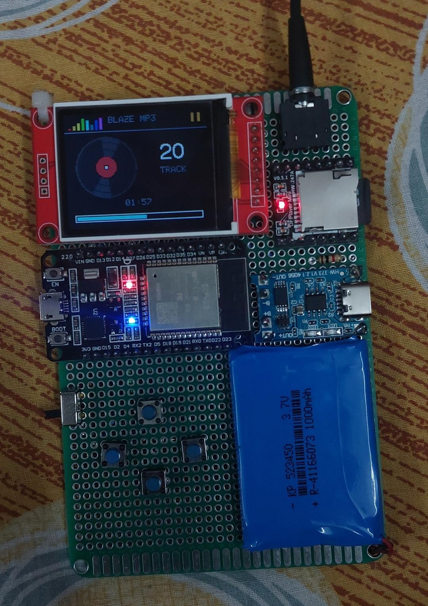
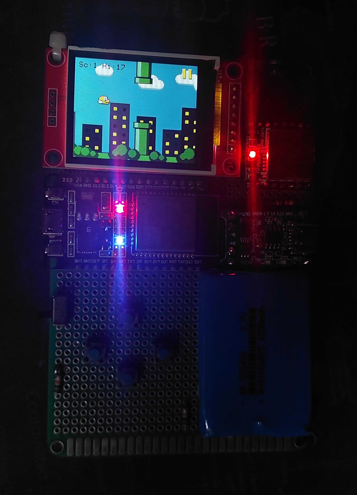

# 🎵 ESP32 Mini MP3 Player

##### IGNORE THE RESISTORS IN THE IMAGE PLEASE THEY ARE JUST FOR COSMETIC PURPOSES I ADDED THEM WHILE PROTOTYPING BUT THEY WEREN'T NEEDED FOR THE PROJECT BUT WELL LOOKS COOL LOL!

A compact offline music player built using an ESP32, a 1.8-inch TFT display, and a DFPlayer Mini. It features a custom music-player interface, animated spinning disc, physical controls, and stereo headphone output. Though the headphone output is not outstanding since the internal audio output is still low the code is friendly to use so you can change the name of the OS lol lmao!

## ✨ Features

- Offline MP3 playback from a microSD card
- Custom TFT music-player interface
- Animated spinning disc during playback
- Track number and playback progress
- Physical music controls
- Equalizer presets
- Repeat-one (Loop) mode
- 3.5 mm stereo headphone output
- Portable LiPo battery power

## 🧰 Hardware

- ESP32 Dev Module
- 1.8-inch ST7735 TFT display (160 × 128 landscape)
- DFPlayer Mini MP3 module
- microSD card
- PJ306 3.5 mm stereo headphone jack (any type of jack will work)
- 4 momentary push buttons
- 3.7 V LiPo battery
- Suitable battery charging, protection, and voltage-regulation circuit
- Connecting wires

## 📚 Libraries Used

| Library | Purpose |
|---|---|
| [TFT_eSPI](https://github.com/Bodmer/TFT_eSPI) | Controls the TFT display and draws the interface |
| [DFRobotDFPlayerMini](https://github.com/DFRobot/DFRobotDFPlayerMini) | Controls MP3 playback and supported audio functions |

**Platform:** ESP32 Arduino Core

The project also uses standard Arduino functions for button input, timing, and serial communication.

## 🔌 Wiring

### TFT Display → ESP32

| TFT Pin | ESP32 Pin |
|---|---|
| VCC | 3V3 |
| GND | GND |
| SCL / SCK | GPIO 18 |
| SDA / MOSI | GPIO 23 |
| CS | GPIO 5 |
| A0 / DC | GPIO 2 |
| RESET / RST | GPIO 4 |
| LED / BL | 3V3 |

### DFPlayer Mini → ESP32

| DFPlayer Pin | ESP32 Pin |
|---|---|
| TX | GPIO 16 |
| RX | GPIO 17 |
| GND | Common GND |
| VCC | Suitable regulated supply |

### Buttons → ESP32

| Button | GPIO |
|---|---|
| Previous | GPIO 32 |
| Play / Pause | GPIO 33 |
| Next | GPIO 25 |
| EQ / Loop | GPIO 26 |

Connect each button between its assigned GPIO pin and GND. Configure the pins with `INPUT_PULLUP`.

### Headphone Jack

| Jack Pin | Connection |
|---|---|
| C / Common | GND |
| R | DFPlayer DAC_R |
| L | DFPlayer DAC_L |
| SR | Not connected |
| SL | Not connected |

Check the pin numbering against your specific jack's diagram before wiring. Use the DFPlayer's DAC outputs, not its speaker outputs.

## 🎮 Button Controls

| Button | Action |
|---|---|
| Previous | Previous track |
| Previous (hold) | Seek backward |
| Play / Pause | Toggle playback |
| Next | Next track |
| Next (hold) | Seek forward |
| EQ / Loop (short press) | Change equalizer preset |
| EQ / Loop (long press) | Toggle repeat-one mode |

## 💾 Music Setup

1. Format the microSD card as FAT32.
2. Create a folder named `MP3`.
3. Name your music files `0001.mp3`, `0002.mp3`, `0003.mp3`, and so on.
4. Copy the files into the folder.
5. Insert the card into the DFPlayer Mini.

## ⚙️ Arduino IDE Setup

1. Install the ESP32 board package in Arduino IDE.
2. Install the **TFT_eSPI** library.
3. Install the **DFRobotDFPlayerMini** library.
4. Configure TFT_eSPI for your ST7735 display, including its driver, pins, and screen dimensions.
5. Select your ESP32 board and serial port.
6. Upload the project code.

## 🔋 Power

Use a suitable charging, protection, and voltage-regulation circuit for the 3.7 V LiPo battery. Do not connect the battery directly to the ESP32's 3V3 pin. Verify the voltage requirements of your exact ESP32 board, TFT display, and DFPlayer Mini before powering the circuit. (Eh just through the charging module connect positive terminal to vin and negative to ground it will work)

## 🎮 Game Disclaimer

All games included in this device are created from scratch for personal, recreational, and educational purposes only. They are not intended for commercial use, sale, or distribution for profit. The games are original creations developed for this project.

## Fun Part:

There are 12 games made for this and the player.ino, roadfighter.ino, pacman.ino upload them all together please. with those there are utility apps like timer, stopwatch and weather and time which will connect via WiFI that you have to setup in the code in the starting lines of player.ino. when the sd card is inserted in the DF player the player interface will load and you have to press previous and next button and hold to inter the apps and games interface. And if you do not have an sd card at the moment and still boot up the device will fallback and open the apps and games directly. I haven't put a buzzer for internal game audio but if you can please do. 

## 🚧 Project Status

**Work in progress.**

The goal is to build a compact, portable music player with a clean interface and simple physical controls.

## ❤️ Credits

- Bodmer — TFT_eSPI library
- DFRobot — DFPlayer Mini library

**Made with ESP32 and a love for music.**

## Summary

The ESP32 Mini MP3 Player is a compact, portable music player built for offline entertainment. It combines MP3 playback, a custom TFT interface, physical controls, and original recreational mini-games in one device. The project is developed for personal, non-commercial use, with a focus on learning, creativity, and embedded systems development.
